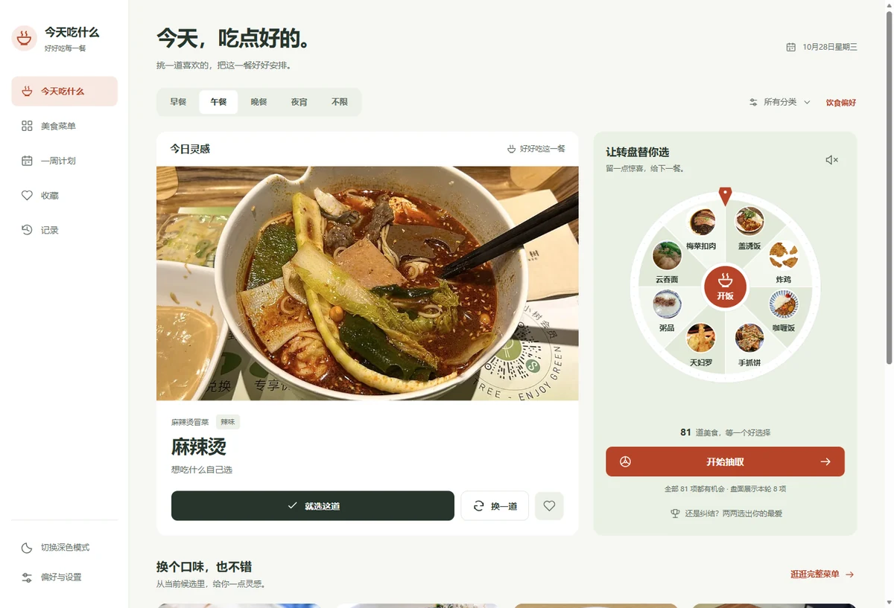

# 今天吃什么

一个可以离线使用的美食决策与用餐计划工具。保留原来的转盘、收藏、淘汰赛与附近店铺，新增一周计划、统一饮食偏好和完整数据备份。

[打开应用](https://gwshhh.github.io/chishenme/)

v3.2.0 以实物大图和快速选择为首页重心，采用桌面侧导航与手机底部导航。可以直接「就选这道」或「换一道」灵感；实物转盘继续保留。图片提供 160 / 480 / 960px 的 WebP，收藏与切换主题保留已显示图片，菜单按 24 道分批展示。

在同一慢网/CPU 限速实验中，推荐大图完成加载由 11.79 秒降至 3.81 秒，已完成请求的传输量减少约 73%。测试条件和原始结果见 [性能记录](docs/performance-v3.2.json)，不是所有网络环境下的耗时承诺。



## 启动

需要 **Node.js 22.9 或更新版本**，推荐 Node.js 24。应用运行不依赖第三方服务包，也不需要打包：

```sh
npm start
```

打开 **http://127.0.0.1:4173**。前端使用 ES modules，请通过 HTTP 服务打开，不能直接双击 `index.html`。

修改代码时使用：

```sh
npm run dev
```

开发模式禁用本应用的 Service Worker，避免离线缓存遮住修改。修改前端后刷新页面；修改服务端时 Node 自动重启。普通 `npm start` 保留 PWA 与离线功能。

## 功能

- **实物照片转盘**：91 道内置美食、13 个分类；餐次与分类筛选、近 7 天选择降权、避免连续重复、天气参考、音效和主动开启的摇一摇。盘面最多展示 8 项，菜名与照片始终正向，支持点击中心「开饭」或下方按钮；结果从全部合格候选中选择，落定时指针、照片高亮与结果对应。
- **菜单与收藏**：搜索菜名/分类/描述，按名称或收藏排序；不想吃清单；同一套菜品详情、分享图片和外卖搜索入口。
- **一周计划**：安排早午晚三餐，一键填补空位，手动选菜、换一道、锁定、已吃打卡、复制周计划。重排保留锁定和已吃的餐次；内置甜品饮品不会单独充当自动安排的一餐。
- **饮食偏好**：不吃辣、蛋奶素参考、清淡优先、排除关键词和单道菜。转盘、推荐、收藏随机与自动计划共用规则。候选不足会说明原因，不会暗中放宽条件。
- **完整备份**：导出和恢复收藏、记录、菜单、计划与偏好。导入先校验并预览，确认后整体替换；格式错误不修改现有数据。
- **自定义菜单**：添加、编辑、删除、JSON 导入导出；支持食堂等整套替换模式。替换模式新增内容也能正确保存，导出包含当前完整菜单。
- **使用体验**：照片优先的首页、桌面侧导航、手机底部导航、六种配色与深色模式；转盘通过 Web Animations 合成层旋转，键盘和减少动态设置可用。优先店铺/菜品原图，第一张失效会尝试其他照片。原图缺失时按明确菜名、品牌或品类匹配已有实物参考图，并显示“参考图”，全部不可用才保留名称卡。
- **记录**：区分“选择过”与“实际吃过”，保留最近 300 条。抽取不会自动记为吃过。
- **PWA**：可安装；已缓存页面和看过的照片可离线使用。新版本就绪后点击页脚更新按钮应用，不在操作中强制切换。

饮食标签来自常见做法或用户自行标注，不是配料保证。严格“不吃辣/蛋奶素”不会纳入缺少对应标签的附近店铺；实际配料请向商家确认。

## 附近店铺与服务配置

复制 `.env.example` 为 `.env`，填写高德 **Web 服务**密钥：

```dotenv
AMAP_KEY=你的高德Web服务密钥
PORT=4173
HOST=127.0.0.1
```

`.env` 已被 Git 忽略，**不要把密钥填回前端或提交到仓库**。此次重构已将工作区原有配置迁至本地 `.env`。旧版本曾公开过的密钥建议在正式发布前更换，并按高德控制台能力限制使用范围。

浏览器只在点击“定位找店”后申请定位。服务端负责坐标转换、地图访问、天气、超时、缓存和限流；没有配置密钥时本地功能正常，附近区域提示使用外卖平台入口。返回的店铺来自高德，不代表一定在外卖平台收录或正在营业。

可选环境变量：

| 变量 | 用途 |
|---|---|
| `PORT` | 端口，默认 4173 |
| `HOST` | 绑定地址，默认只允许本机；局域网测试可设 `0.0.0.0` |
| `ALLOWED_ORIGIN` | 独立静态站点的确切来源，例如 `https://example.com`，不带路径或尾部斜线 |
| `HTTPS_KEY` / `HTTPS_CERT` | 可选 TLS 证书路径；真机定位需要 HTTPS |

旧的 `node dev_server.js` 命令仍可用，作为本地 HTTPS 兼容入口，默认 8443，使用原有 `_dev_key.pem` / `_dev_cert.pem`。也可以通过上述变量提供自己的证书。

## 静态部署与 Node 部署

GitHub Pages 地址为 [https://gwshhh.github.io/chishenme/](https://gwshhh.github.io/chishenme/)，由仓库 `master` 分支根目录自动发布；`.nojekyll` 保证静态模块和资源按原样提供。

**纯静态托管**：发布 `index.html`、`app.js`、`data.js`、`config.js`、`runtime-config.json`、`styles.css`、`src/`、`images_food/`、`sw.js`、`sw-assets.js`、manifest 与图标。相对路径支持 GitHub Pages 子目录；默认启用全部本地功能。

**静态站点 + 独立 API**：在 `config.js` 中设置公开的 `apiBase: 'https://你的服务/api/'`，并在后端 `.env` 配置 `ALLOWED_ORIGIN=https://你的静态域名`。`apiBase` 是地址，不是密钥。

**Node 一体托管**：运行 `npm start`，生产环境放在 HTTPS 反向代理后；静态文件和 API 同源。服务端只提供允许公开的文件，不提供 `.env`、证书、Git 元数据或服务端源码。

## 数据与兼容

新数据集中保存于 `localStorage['chishenme:state:v1']`。在**同一浏览器、同一来源地址**访问新版时，会兼容读取旧版收藏、历史、自定义菜单、替换菜单和主题，保留旧存储键。不同浏览器、域名或端口的数据不会自动互通，可使用完整备份迁移新版数据。

存储不可用或配额已满时，应用仍可在当前会话使用并显示提示，请离开前导出备份。损坏或不支持的主数据会先保留原文，后续成功保存时归档到 `chishenme:recovery:v1`。附近位置只用于当前会话，完整备份不包含位置或服务密钥。

菜单导入兼容旧 JSON 数组，也接受带版本的菜单文件。示例：

```json
[
  {
    "name": "番茄鸡蛋面",
    "category": "食堂",
    "description": "二楼面食窗口",
    "meals": ["breakfast", "lunch", "dinner"],
    "tags": ["mild", "vegetarian"]
  }
]
```

`meals` 可用 breakfast / lunch / dinner / night；`tags` 可用 mild / spicy / vegetarian / light。不确定的口味留空。导入上限 500 道菜、文件上限 2 MB。

## 开发与验证

```sh
npm ci
npm run check
npm test
npm run test:browser
python -m unittest discover -s tests -p "test_*.py"
```

Windows 浏览器测试默认使用已安装的 Edge。其他平台先运行 `npx playwright install chromium`；也可用 `PLAYWRIGHT_CHANNEL` 指定浏览器。测试服务使用 4174 端口，不加载真实密钥，不调用真实地图。

需要明确执行真实地图/天气联调时：

```sh
npm run smoke:providers
```

此命令使用固定公开测试坐标和 `.env` 中的配置，会访问外部服务。常规测试完全隔离第三方接口。

架构见 [docs/architecture.md](docs/architecture.md)，验收记录见 [docs/verification.md](docs/verification.md)，视觉规则见 [DESIGN.md](DESIGN.md)，日常使用见 [使用指南.md](使用指南.md)。

## 维护图片和发布版本

`data.js` 的 `IMAGE_ORDER` 是图片编号的唯一来源；Python 下载/名称卡脚本通过 `scripts/catalog_assets.py` 读取，不再维护重复列表。新增菜品在 `foodData` 和 `IMAGE_ORDER` 登记，并在 `src/core/catalog.js` 补充餐次/口味规则。已退休图片槽位不删除，避免后续序号错位。

`fetch_real_images.py` 是可选素材下载工具，`generate_images.py` 是旧版离线名称卡导出工具；应用运行时不依赖它们。现有照片沿用项目资产。

更新 JPEG 后，使用支持 WebP 的 Pillow 运行 `python scripts/optimize_images.py`，生成 `images_food/optimized/` 下的三个尺寸并一起发布。160px 用于转盘，菜单/计划按显示尺寸加载，主推荐/详情使用大图；原始 JPEG 保留用于分享与优化图失败兜底。`npm run check` 检查所有派生文件和缩略图大小预算。发布时应包含完整 `images_food/` 目录。

`src/core/photos.js` 统一卡片、详情、收藏、计划与分享的图片候选。参考图不写回店铺原图字段，也不代表该店实际出品；无法识别的店铺不会随意配不相关菜品图。返回的多张照片会随收藏和备份保留，恢复联网后会重试失败原图。

发布应用代码时，同步更新 `src/core/model.js` 的 `APP_VERSION`、`sw-assets.js` 的版本、package 版本，以及 `index.html` 中入口脚本/样式的 `?v=`；校验命令会检查它们是否一致。新增浏览器模块加入 `APP_ASSETS`。运行校验和测试后再部署。Service Worker 以版本和站点路径隔离缓存，确保旧页面不会混用新模块。

本轮参考 [Mealie](https://github.com/mealie-recipes/mealie) 的照片菜单组织、[shadcn/ui](https://github.com/shadcn-ui/ui) 的控件与状态细节，以及 [Anthropic frontend-design](https://github.com/anthropics/skills/tree/main/skills/frontend-design) 的设计方法。实现保留原生 ES modules，没有引入这些项目的运行时代码。
