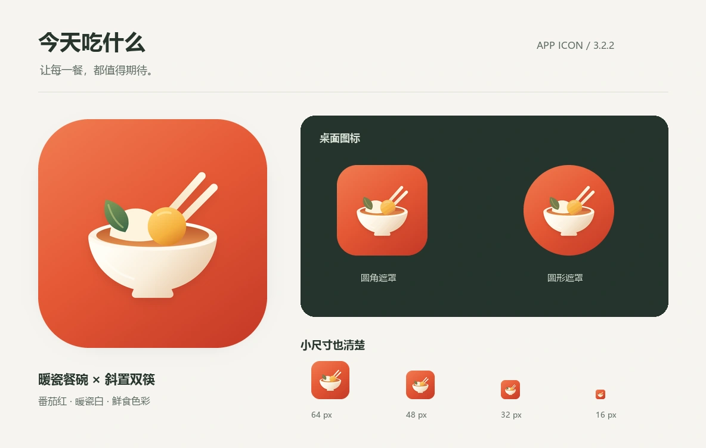

# 今天吃什么 · APP 图标

v3.2.2，2026-10-28。按用户要求重新构图，彻底移除问号标志。



## 设计

番茄红底色上，一只暖白餐碗承托金色食材，斜置双筷与青绿叶片平衡构图。用大轮廓、充足留白和少量平滑明暗表达轻盈的瓷器质感；缩小时依靠碗筷形状与食材色块识别。图标没有问号、蒸汽符号或细小文字。

参考了 GitHub 上 [Phosphor 的填充餐碗](https://github.com/phosphor-icons/core/blob/main/assets/fill/bowl-food-fill.svg)、[双色餐碗](https://github.com/phosphor-icons/core/blob/main/assets/duotone/bowl-food-duotone.svg) 和 [IconPark 的米饭图标](https://github.com/bytedance/IconPark/blob/master/source/Foods/rice.svg)，学习轮廓、留白与层次。此次为项目原生矢量绘制，未复制这些参考的路径或品牌标志，没有调用图片生成 API，也没有新增生产依赖。

设计源：[app-icon-master.svg](../assets/brand/app-icon-master.svg)。圆角浏览器图标与所有 PNG 均从同一来源导出，避免旧版 SVG 与 Pillow 手工重绘形状不同的问题。

## 文件

| 文件 | 用途 |
|---|---|
| `assets/brand/app-icon-master.svg` | 1024px 全出血矢量母版 |
| `icon-1024.png` | 1024px 全彩高清母版，不加入首页或离线预缓存 |
| `icon.svg` | 圆角 SVG，浏览器 favicon 与网页品牌，4,074 bytes |
| `icon-512.png` | PWA 安装图标及 Android maskable，51,915 bytes |
| `icon-192.png` | PWA 小图标，13,051 bytes |
| `apple-touch-icon.png` | iOS 180px 图标，11,541 bytes |
| `favicon-32.png` | 32px PNG favicon |
| `favicon.ico` | 16 / 32 / 48px 浏览器兼容图标 |

原生安装 PNG 均不透明且为完整方形，由系统施加圆角或圆形遮罩；主体通过中央 80% 安全圆检查。安装用 PNG 使用 256 色调色板减少体积，1024px 母版保留全彩。512px 文件比 v3.2.1 减少约 43%，1024px 母版不参与首屏加载或离线预缓存。

## 重新导出

安装现有开发依赖 `npm ci`，准备 Pillow 及 Playwright 浏览器（Windows 默认使用本机 Edge），执行：

```sh
python gen_icon.py
```

`scripts/render-icon.mjs` 使用无界面浏览器渲染 SVG，Pillow 统一缩放、压缩及导出 ICO。不增加任何生产运行时依赖。

## 验证

- 31 项 Node 核心 / HTTP 测试通过。
- 12 项现有桌面 / 手机定向浏览器测试通过，覆盖 320px、200% 字号、WCAG AA 自动规则、子目录、离线与图片性能行为。未重复执行完整浏览器套件。
- 静态校验通过：46 个脚本、38 个离线资源、91 张菜图及其 273 个 WebP。
- 生成脚本确认所有原生 PNG 不透明，主体位于中央 80% 安全圆；favicon 导出 16 / 32 / 48px。
- 查看图标预览，以及 1365px 桌面、390px 手机明暗截图；品牌分别为 42px / 38px，新 SVG 加载成功，手机没有横向溢出。
- 单次设计机械检测覆盖母版、网页 SVG 和 index.html，返回零发现。
- 本地已有 v3.1.0 缓存通过页面更新按钮升级至 v3.2.2，旧 shell 清除，图片缓存使用既有 images-v2。
- 独立代理及重试均遇到环境 403，使用主会话替代复核；见 [视觉复核记录](visual-review-icon-v3.2.2.md)，不宣称独立审查通过。

manifest、图标链接和 shell 版本统一更新到 3.2.2。已安装网页接受页脚「有新版本，点击更新」后切换缓存；手机系统的桌面图标刷新时机由系统控制，仍显示旧图标时可重新添加到桌面。

## 历史：v3.2.1 线上验收

- 应用提交 `83bd135147e911c750bab6a2d09fcd6ed61531ac` 已发布；[Pages 运行 40662180752](https://github.com/Gwshhh/chishenme/actions/runs/40662180752) 成功，构建状态 `built`。
- 7 个线上图标均返回 200，MIME 正确，SHA-256 与本地成品逐一一致。
- 已安装 v3.2.0 的浏览器接受更新后显示 v3.2.1，新 SVG 品牌加载成功，旧 shell 缓存清除；6 个使用中的图标均进入新 shell 离线缓存，高清母版不预缓存。
- 本次升级浏览器原本没有保存的数据，前后均保持空状态；有数据的离线场景由本次现有自动化用例验证，不将空状态升级写成完整数据迁移验收。
- 线上控制台无错误。本地 4173 预览服务也已重启到 3.2.1。
